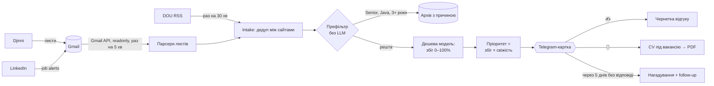

# Job Hunter Bot

Особистий Telegram-бот для пошуку роботи. Збирає вакансії з Djinni, DOU і LinkedIn, відсіює явно нерелевантні без LLM, оцінює решту під твій профіль, ранжує за збігом і свіжістю, пише чернетку відгуку, збирає CV під конкретну вакансію в PDF, нагадує про follow-up і веде статуси заявок.

**Бот нічого не надсилає сам.** Модель готує текст, а копіюєш і відправляєш його ти. Це свідомо: автоподача — це спам, який рекрутери відсіюють, і ризик бану на Djinni.

## Як це працює



| Джерело | Як потрапляє | Що є у вакансії |
|---|---|---|
| Djinni | листи «Нові вакансії» в Gmail + сторінка вакансії | повний опис, дата публікації, вимога до досвіду |
| DOU | RSS `jobs.dou.ua/vacancies/feeds/` (Jobs:DouFeeds) | повний опис, дата публікації. ⚠️ DOU стоїть за Cloudflare, який не пускає IP дата-центрів (DigitalOcean, Hetzner) навіть до RSS. Бот це не обходить: на такому сервері `Jobs__DouEnabled=false`, з домашнього IP працює |
| LinkedIn | листи job alerts у Gmail | тільки назва, компанія, локація: сторінки LinkedIn бот не читає (це заборонено їхніми правилами) |
| Будь-яке | посилання djinni.co/jobs/… у чаті | як у Djinni |

Одна й та сама вакансія на кількох сайтах стає однією карткою з рядком «📎 Також на: DOU».

| Подія в пошті | Що робить бот |
|---|---|
| Нові вакансії (Djinni / LinkedIn) | Префільтр → оцінка → картка з кнопками «✍️ Написати відгук», «📄 CV під вакансію», «⏭ Пропустити» |
| «Повідомлення від …» | Надсилає текст рекрутера, ставить вакансії статус «📩 є відповідь», пропонує «💬 Чернетку відповіді» |
| Ввічлива відмова або «ви не підійшли» | Ставить статус «❌ відмова» |
| Автовідповідь «дякуємо за відгук» | Тихо ставить статус «📤 подано» |
| 5 днів після «✅ Я подався» без відповіді | Нагадує і пише коротке follow-up повідомлення (з 10:00 до 20:00) |

Щоранку о 09:00 (Київ) приходить дайджест: нові вакансії, чернетки, які ще не подані, і відповіді.

## Під капотом

- **Gmail без бібліотеки Google.** Два REST-ендпоінти (`messages.list`, `messages.get`) і refresh token через `HttpClient`. Access token живе в пам'яті й оновлюється за 2 хвилини до закінчення. Скоуп `gmail.readonly`: бот фізично не може відправити, змінити чи видалити лист.
- **OAuth для desktop-застосунку.** `gmail-auth` піднімає listener на `127.0.0.1:<випадковий порт>`. Захищають його два механізми:
  - PKCE (S256): код авторизації марний без `code_verifier`, який не залишає процес.
  - `state`: listener приймає тільки той редірект, який він сам ініціював.
- **Парсинг листів без LLM.** Djinni шле листи у стабільному форматі, тому класифікація працює на правилах: тема листа плюс маркери відмови й автовідповіді. Це дешево, детерміновано і покрито тестами. Ідемпотентність тримається на унікальному індексі `GmailId`: повторний прогін нічого не дублює.
- **Два джерела правди.** Лист дає id вакансії і короткий опис, а сторінка вакансії дає точні назву, компанію і повний опис. Якщо Djinni змінить верстку листа, вакансія все одно доїде.
- **Prompt injection.** Текст вакансії і листа — це чужі дані. Вони йдуть у user-повідомлення в тегах `<vacancy>`, а не в system prompt.
- **Захист від галюцинацій.** `SkillGrounding` перевіряє чернетку за словником технологій. Якщо модель приписала тобі, наприклад, Kafka, а в профілі її немає, вона отримує одну спробу переписати текст. Якщо не вийде, картка показує попередження.
- **Префільтр без LLM.** `VacancyPrefilter` відкидає Senior/Lead/Architect, чужий стек (Java, PHP, QA, iOS…) і вимогу досвіду понад `Jobs:MaxExperienceMonths`. Junior у назві перемагає «lead», .NET у назві перемагає «Python». AI/ML-ролі лишаються моделі. Відфільтровані вакансії лежать в архіві з причиною, і їх можна «🎯 Все одно оцінити».
- **Дві моделі.** Оцінка йде на дешеву `OpenAI:CheapModel` (≈20× дешевше), а тексти, які читає рекрутер (відгук, follow-up, CV), пише основна `OpenAI:Model`.
- **Prompt caching.** Статична частина промпту (інструкції + профіль або CV) стоїть першою, вакансія — в кінці. OpenAI кешує префікс від 1024 токенів, і кешовані токени у 10–20 разів дешевші за звичайні. `/status` показує кеш і reasoning-токени окремо.
- **Пріоритет = збіг × свіжість.** Кількість відгуків Djinni показує тільки залогіненим, тому конкуренцію замінює вік вакансії: за перші дні набирається більшість відгуків. Свіжа вакансія з 70% стоїть вище за двотижневу з 78%.
- **Дедуп між сайтами.** Ключ — «компанія|назва» тільки з літер і цифр, кириличні двійники (`С#` з DOU) зведені до латиниці.
- **CV без вигадок.** Модель отримує каталог твого CV з id і повертає тільки план: які проєкти, які пункти, в якому порядку. Кожен пункт у PDF — твій оригінальний текст. Вільний текст — лише заголовок і summary, і їх перевіряє `SkillGrounding`.
- **PDF.** QuestPDF (Community license) з вбудованим шрифтом Inter: однаково на Windows і в Docker, кирилиця не залежить від системних шрифтів.
- **Бюджет.** `LlmBudgetGuard` рахує токени по кожній моделі й зупиняє виклики після `OpenAI:DailyBudgetUsd` за день. Плюс hard limit на боці OpenAI.
- **Приватність.** Бот відповідає тільки `Bot:OwnerId`. Профіль кандидата зберігається в SQLite на сервері, а не в репозиторії.

## Налаштування

### 1. Google Cloud: доступ до пошти (≈5 хв, один раз)

1. https://console.cloud.google.com → створи проєкт `job-hunter`.
2. **APIs & Services → Library** → увімкни **Gmail API** і **Google Calendar API**.
3. **Google Auth Platform → Branding**: назва застосунку і твій email. **Audience**: External.
4. **Audience → Publish app** (статус *In production*).
   - Навіщо: у статусі *Testing* Google видає refresh token, який живе 7 днів. Через тиждень бот осліпне.
   - Чого очікувати: побачиш попередження «Google hasn't verified this app». Для особистого застосунку це нормально: тисни *Advanced → Go to … (unsafe)*.
5. **Clients → Create client → Desktop app**. Скопіюй Client ID і Client secret.

### 2. Refresh token (на своєму ПК)

```powershell
dotnet run --project src/SystematiaBot.Cli -- gmail-auth --client-id "<id>" --client-secret "<secret>"
```

Відкриється браузер. Увійди в акаунт, куди приходять листи Djinni. У терміналі з'явиться рядок `Gmail__RefreshToken=…`.

### 3. Сервер (Docker)

```bash
git clone https://github.com/Msk3123/tgJobBot.git jobhunter && cd jobhunter
git checkout job-hunter
cp .env.example .env && nano .env      # токен бота, OwnerId, OpenAI, три Gmail-змінні
docker compose up -d --build
docker compose logs -f
```

### 4. Профіль

Надішли боту `/profile` → «✏️ Замінити профіль» → одним повідомленням: досвід, проєкти з цифрами, стек, англійська, які ролі шукаєш, зарплата, формат. Усі оцінки й чернетки будуються тільки на цьому тексті.

### 5. CV

`/cv` → «🧩 Шаблон JSON» → заповни своїми даними → надішли файл `.json` боту. Він збереже CV в базі (не в git) і одразу пришле базовий PDF. Далі в кожній картці вакансії є «📄 CV під вакансію».

На сервері можна без Telegram: поклади `profile.txt` і/або `cv.json` у `data/` поруч з базою і перезапусти бота. Файл імпортується до першої синхронізації і перейменовується в `*.imported`.

Перевірити вигляд локально, до завантаження: `dotnet run --project src/SystematiaBot.Cli -- cv-pdf cv.json` (поруч з'явиться `cv.pdf`).

### 6. LinkedIn (за бажанням)

LinkedIn → Jobs → пошук «.NET Developer» (або «C# Developer»), локація Львів або Україна, фільтри Entry level / Internship → **Set alert**, частота Daily, сповіщення на e-mail. Листи прийдуть у той самий Gmail, і бот їх підхопить.

## Команди

| Команда | Що робить |
|---|---|
| `/start` | Головне меню |
| `/new` | Нові вакансії |
| `/apps` | Мої заявки |
| `/sync` | Перевірити пошту і DOU зараз |
| `/profile` | Профіль кандидата |
| `/cv` | CV: базовий PDF, завантаження нового `.json`, шаблон |
| `/status` | Gmail, DOU, токени й витрати по моделях за день і місяць, остання помилка |

## Розробка

```powershell
dotnet build
dotnet test
dotnet user-secrets set "Telegram:BotToken" "<токен тестового бота>" --project src/SystematiaBot.Bot
dotnet run --project src/SystematiaBot.Bot
```

Для локального запуску бери окремого тестового бота від @BotFather. Два процеси з одним токеном конфліктують на `getUpdates`.
